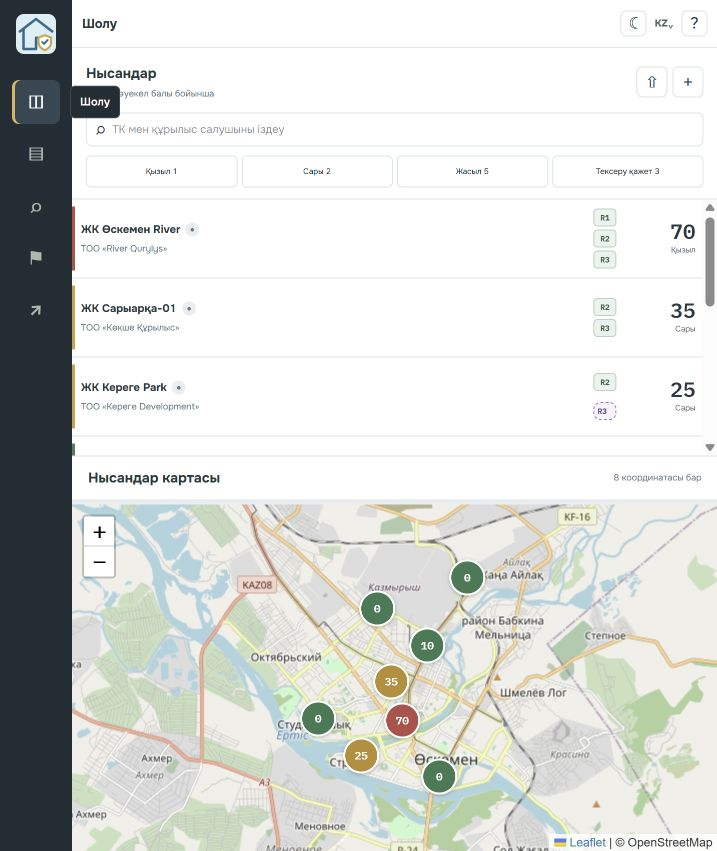
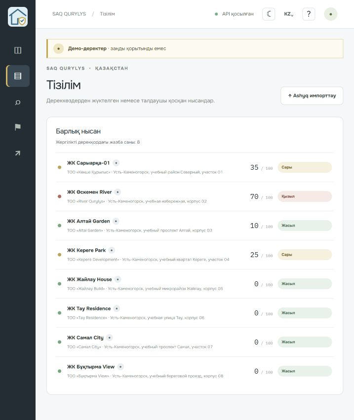
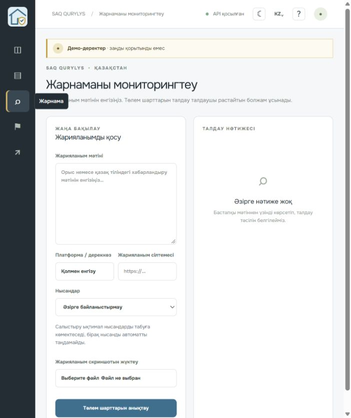
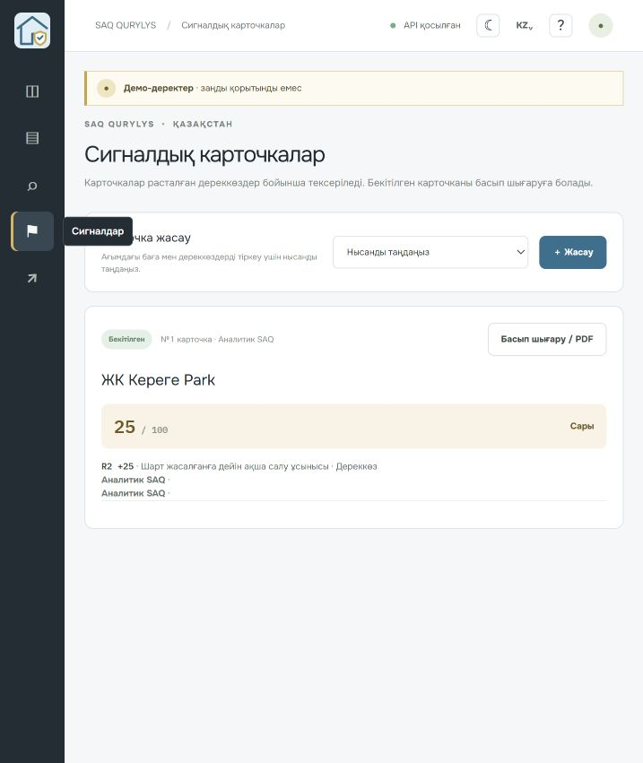
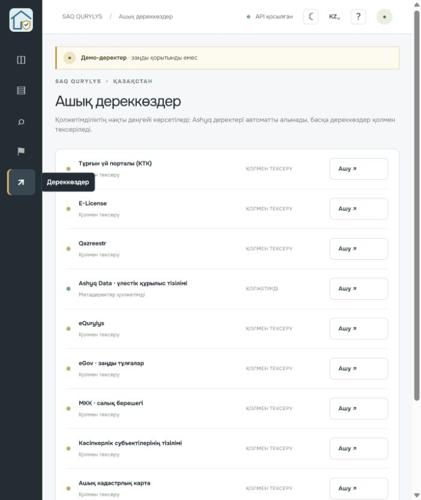

# SAQ QURYLYS

Прототип системы мониторинга открытых сведений о строящихся жилых объектах Казахстана. Он объединяет импорт реестра, проверку источников, разбор рекламных текстов, журнал решений и сигнальные карточки. Система не выносит юридических заключений: гипотезы и правовые основания подтверждает аналитик.

## Запуск на Windows (папка без кириллицы, например `C:\work\saq-qurylys`)

Требуются Python 3.11+ и Node.js 20+.

Короткий порядок запуска — 4 шага установки, затем отдельные команды старта двух серверов:

```powershell
python -m venv .venv
.\.venv\Scripts\Activate.ps1
python -m pip install -r requirements.txt
Copy-Item .env.example .env
```

Затем явно загрузите учебные данные (`python -m backend.seed.seed`) либо оставьте базу пустой. Команда загружает 8 вымышленных ЖК и 12 публикаций. На обзоре доступна такая же кнопка. Новая установка не загружает seed автоматически.

### Вход и роли

Перед первым запуском задайте в локальном `.env` случайный `SESSION_SECRET` (например, `python -c "import secrets; print(secrets.token_urlsafe(48))"`). При желании задайте пароли `SAQ_PASSWORD_ANALYST`, `SAQ_PASSWORD_ANALYST_BACKUP` и `SAQ_PASSWORD_OBSERVER` там же. Затем выполните `python -m backend.seed.seed`: команда создаст вымышленные учётные записи `analyst`, `analyst.backup` и `observer`, сохранив только Argon2-хэши. Если пароли не заданы, команда сгенерирует одноразовые и выведет их в терминал; сохраните их в менеджере паролей. Паролей в репозитории нет.

Пользователи предсозданы, самостоятельной регистрации нет. Имена учётных записей: `analyst` (аналитик А), `analyst.backup` (аналитик В), `observer` (наблюдатель Б). Для чистой установки задайте собственные пароли через локальный `.env` или используйте одноразовые, показанные seed-командой; не публикуйте их.

Аналитик может менять данные и подтверждать решения; наблюдатель имеет доступ только на чтение. Backend проверяет роль для каждого изменяющего API-запроса. После пяти неудачных попыток вход блокируется на 15 минут для этой пары адреса клиента и логина. Лимитер хранится в памяти процесса, поэтому для публичного развёртывания добавьте внешний rate limiter.

В первом терминале запустите API:

```powershell
python -m uvicorn backend.app.main:app --reload
```

Во втором терминале запустите веб-интерфейс:

```powershell
cd frontend
npm install
npm run dev
```

Откройте адрес Vite, обычно `http://localhost:5173`. Автодокументация API доступна по адресу `http://127.0.0.1:8000/docs`. SQLite файл создаётся автоматически при запуске в `backend/data/saq_qurylys.db`; таблицы создаются пустыми. Вымышленные записи не загружаются автоматически.

### Запуск на Linux/macOS

```sh
python3 -m venv .venv && . .venv/bin/activate
python -m pip install -r requirements.txt
cp .env.example .env
python -m backend.seed.seed  # по желанию: демо A/B/C
```

В отдельных терминалах выполните `python -m uvicorn backend.app.main:app --reload` и `cd frontend && npm install && npm run dev`.

### Подключить демонстрационный сценарий

Демо набор полностью вымышлен, строки списка и метки карты имеют нейтральный маркер с подсказкой «Демонстрационные данные»; записи не содержат действительных БИН. Он нужен только для прогона сценариев A/B/C и показа интерфейса. Запускайте его явно:

```powershell
python -m backend.seed.seed
```

Команду можно запускать повторно: она пересоздаёт только записи ДЕМО. Импортированные реальные строки сохраняются.

## Реальные данные

На странице «Обзор» или «Реестр» загрузите CSV/XLSX из [набора Ashyq Data о долевом участии](https://ashyq.data.gov.kz/dataset/magda-ds-b80110e9-218a-42ba-b8c8-01fa5e4c82c8). Импорт ограничен 5 МБ и 25 000 строками, формирует списки принятых и пропущенных строк с причинами, дедуплицирует записи и сохраняет источник, набор и время загрузки. Неописанные поля не сохраняются; ФИО в поле названия отклоняется. Импортированная запись не создаёт R1. Результат «не найдено» требует ручной проверки; R1 добавляется только аналитиком с URL источника.

Реальная выгрузка Ashyq в этой среде не предоставлена и не проверена. Парсер и маппинг проверены на искусственном образце [`data/sample/ashyq-synthetic-sample.csv`](data/sample/ashyq-synthetic-sample.csv), составленном по опубликованным заголовкам (`object_id`, `object_location`, `builder_name`, `authorized_org_name`, `object_address`, `date_start`, `date_end`, `permission_number`, `time_modif`). Это не подтверждает совместимость со всеми вариантами настоящего файла; при первой загрузке сверьте заголовки и смысл полей с первоисточником. Сопоставление значений и их актуальность аналитик проверяет вручную.

### Публичные Telegram-публикации

На странице «Реклама» можно загрузить искусственный образец или экспорт `result.json`, сделанный Telegram Desktop для публичного канала. Каждое обычное сообщение сохраняется как публикация с каналом, датой, публичной ссылкой (когда она присутствует), текстом и временем захвата; затем выполняются правила и подбор кандидатов ЖК. Аналитик выбирает связь. Авторы и телефоны экспорта не сохраняются; телефонные номера в тексте не извлекаются в отдельные поля. Ограничение файла — 5 МБ, максимум 10 000 сообщений. Проверен только искусственный образец [`data/sample/telegram-result.json`](data/sample/telegram-result.json), не экспорт реального канала.

Реальные файлы храните в `data/raw/` или загружайте через интерфейс. Каталог `data/raw/` исключён из Git. В `data/sample/` допустимы только искусственные строки. Импортёр сохраняет настроенные публичные поля, отбрасывает остальные столбцы и отклоняет распознанные ФИО из поля названия. Перед импортом проверьте исходный набор на ПДн. Скриншоты публикаций хранятся локально в `backend/data/screenshots/`, исключённом из Git.

API показывает доступность метаданных Ashyq. Прямую загрузку набора можно выполнить вручную с официальной страницы: в текущей конфигурации хост CSV может отдавать некорректный TLS-сертификат, поэтому приложение не отключает проверку TLS. Для Homeportal, E-License, Qazreestr, eQurylys, eGov, КГД, РСП, кадастровой карты и РНУ оставлены ссылки для проверки человеком. Автоматический доступ к закрытым или нестабильным интерфейсам не имитируется.

## ИИ и извлечение

Проверено в режиме правил; LLM-режим реализован, но не тестировался с ключом. Без ключа работает локальный словарь русских и казахских формулировок. Опционально задайте `AI_API_KEY`, `AI_BASE_URL` и `AI_MODEL` в `.env` для OpenAI-compatible chat completions. LLM используется только для извлечения цитаты. Цитата проверяется на точное присутствие в тексте объявления. При сетевой ошибке включаются локальные правила. Ни API ключ, ни полный текст рекламы не записываются в журнал аудита. Уверенность показывается процентом и словесным уровнем, низкая уверенность отмечена отдельно.

Разбор рекламы не устанавливает связь с ЖК сам по себе. Аналитик выбирает объект вручную. Обнаруженная формулировка и связь с активным объектом создают гипотезу R2/R3; баллы появятся только после явного подтверждения цитаты.

## Оценка

Факторы: R1 — 35, R2 — 25, R3 — 10, R4 — 15, R5 — 10, R6 — 5 баллов. Повторные подтверждения одного кода не складываются. R1 создаётся только после проверки правового основания с URL источника. Неизвестное или недоступное состояние не считается R1. Красная зона требует одновременно не менее 60 баллов, подтверждённые R1 и R2; жёлтая начинается с 25; ниже — зелёная. Границы и контрольные сценарии проверяются тестами.

## Сквозной сценарий для защиты

1. Запустите приложение, затем выполните `python -m backend.seed.seed`, чтобы явно загрузить контрольные ДЕМО-данные.
2. В реестре откройте **ЖК Қоңырсай-71**: сценарий B показывает **70 баллов, красную зону** и факторы R1, R2, R3. Вымышленные строки помечены ДЕМО и не являются сведениями о реальном ЖК.
3. На «Обзоре» нажмите «Добавить объект», создайте объект «Пробный ЖК» и откройте страницу «Реклама».
4. Введите текст `Внесите депозит 500 000 за бронь квартиры в строящемся доме.`, укажите тестовый адрес публикации `https://example.org/demo-ad`, выберите «Пробный ЖК» и нажмите «Извлечь условия оплаты».
5. Откройте карточку «Пробный ЖК». R2 появится как гипотеза, а балл останется **0**. Добавьте ссылку на источник и нажмите «Подтвердить»: балл станет **25**, зона — **жёлтая**.
6. На странице «Сигналы» создайте карточку для ЖК Қоңырсай-71, передайте её на проверку и подтвердите. Оценка карточки — **70**, зона — **красная**. Кнопка «Печать / PDF» вызывает системную печать браузера.

Повторный запуск seed пересоздаёт контрольные демо-объекты и связанные с ними записи. Для повторения шага 5 создайте новый тестовый объект.

## Что реализовано и что нет

**Реализовано:** локальная база SQLite; скоринг только подтверждённых факторов; зоны с условиями R1/R2 для красного уровня; объяснение балла со ссылками на записи доказательств и цитатами; изолированный what-if расчёт для ожидающих проверки факторов (не меняет текущий балл); русско-казахские правила извлечения цитат; ручное подтверждение гипотез со ссылкой; ручные отметки по источникам с автором, датой и аудитом; переходы статусов сигнала с автором, временем и аудитом; явные ДЕМО-сценарии A/B/C; импорт CSV/XLSX и Telegram Desktop `result.json`; карта Leaflet для записей с координатами; светлая и тёмная темы.

Контрольные цитаты A/B/C являются вымышленными и берутся из текстов соответствующих ДЕМО-публикаций; тест проверяет совпадение цитаты и текста. Ссылки на seed-публикации используют `example.invalid` и не ведут на реальные объявления.

**Пока не реализовано или не проверено:** автоматическое получение записей из большинства реестров; импорт реального скачанного CSV Ashyq; проверка LLM с ключом; OCR; проверка юридического перевода носителем казахского языка; усиленный многоузловой rate limiting для публичного развёртывания; сохранение PDF в обычном Chrome/Edge. Печать вызывает `window.print`, но её системный диалог и итоговый PDF здесь не проверены. Не выдавайте эти пункты за готовые интеграции.

## Команды

```powershell
python -m pytest backend/tests -q
cd frontend; npm test -- --run
cd frontend; npm run build
cd frontend; npm run lint
```

Для backend поддерживается также `make run`, `make seed`, `make test` в окружении с Make. Чтобы собрать frontend и раздавать его FastAPI, выполните `cd frontend; npm run build`, затем запустите API.

## Структура

```text
backend/app/api/       FastAPI endpoints
backend/app/domain/    правила оценки
backend/app/ai/        извлечение RU/KZ и fuzzy matching
backend/app/adapters/  Ashyq metadata и адаптеры источников
backend/seed/          явный ДЕМО seed и A/B/C сценарии
backend/app/auth.py    cookie-сессии, Argon2, роли и ограничение попыток
backend/tests/         pytest
frontend/src/          React, TypeScript, карта и страницы
docs/                  архитектура, ИИ, демо-сценарий и защита
```

## Языки, темы и обучение

Интерфейс доступен на русском и казахском; выбор языка сохраняется между сессиями в браузере. Есть светлая и тёмная темы: начальная тема учитывает системную настройку, выбранная тема сохраняется локально. Guided Tour запускается автоматически при первом входе и повторно из кнопки обучения; он не меняет данные, а шаги для отсутствующих элементов пропускает.

## Как проверить за 5 минут

1. Выполните `python -m backend.seed.seed` и войдите как `analyst`.
2. В реестре найдите вымышленный ЖК сценария B **Қоңырсай-71**: ожидаемый результат — **70 баллов, красная зона**.
3. Создайте отдельный пустой объект и добавьте публикацию с текстом `Внесите депозит 500 000 за бронь квартиры в строящемся доме.`. До подтверждения гипотезы оценка должна быть **0**.
4. В карточке объекта проверьте гипотезу, укажите ссылку и подтвердите R2: ожидаемая оценка — **25 баллов**. Наблюдатель может увидеть запись, но не может принять решение.
5. Создайте сигнал, переведите его на проверку и подтвердите; проверьте автора и время в журнале, затем откройте печатную версию.

Проверочный сценарий использует только вымышленные seed-записи. Текст рекламы здесь иллюстративный; ссылка `example.org` не является реальным объявлением.

## Скриншоты интерфейса (казахский язык)

Снимки страниц собраны в [`docs/screenshots/`](docs/screenshots/):

| Обзор | Реестр | Реклама | Сигналы | Источники |
|---|---|---|---|---|
|  |  |  |  |  |

PDF-пример сигнала для сценария B: [`docs/examples/scenario-b-signal.pdf`](docs/examples/scenario-b-signal.pdf). В нём использованы только вымышленные учебные сведения.

## Ограничения прототипа

- Вход и роли реализованы: аналитик может менять данные, наблюдатель имеет доступ только на чтение; самостоятельной регистрации, восстановления пароля и email нет. Сессионный секрет должен быть задан локально. Ограничитель попыток входа находится в памяти одного процесса и не предназначен для публичного многосерверного развёртывания.
- Сигналы и импорты хранятся в локальной SQLite базе; это прототип для локального использования, не многопользовательская транзакционная система.
- Ashyq: адаптер запрашивает метаданные; сами записи импортируются из выбранного CSV/XLSX. Импортный код проверен на искусственном образце, полный реальный файл в этой среде не тестировался.
- Telegram: проверен парсер искусственного `result.json`; реальный экспорт не тестировался. Это ручная загрузка экспорта публичного канала из Telegram Desktop, без бота и фоновой синхронизации.
- Для Homeportal, E-License, Qazreestr, eQurylys, eGov, КГД, РСП, кадастровой карты и РНУ доступны ссылки для ручной проверки; автоматическое получение их записей не подключено.
- Локальные RU/KK правила извлечения проверены. LLM-режим реализован, но **не тестировался с настоящим API-ключом**. OCR отсутствует.
- Юридические формулировки на казахском языке требуют проверки носителем; список терминов находится в [`docs/i18n-review.md`](docs/i18n-review.md).
- Координаты не вычисляются по адресу; на карте отображаются только координаты, уже записанные в объекте.
- Печать вызывает `window.print`; в репозитории есть искусственный пример PDF, но системный диалог Chrome/Edge здесь не проверялся.
- Видеозапись не включена в репозиторий; порядок демонстрации описан в [`docs/demo-runbook.md`](docs/demo-runbook.md).

Перед публикацией репозитория проверьте локальные изменения и удалите `.env` и файлы базы, если они появились. Они уже добавлены в `.gitignore`.
